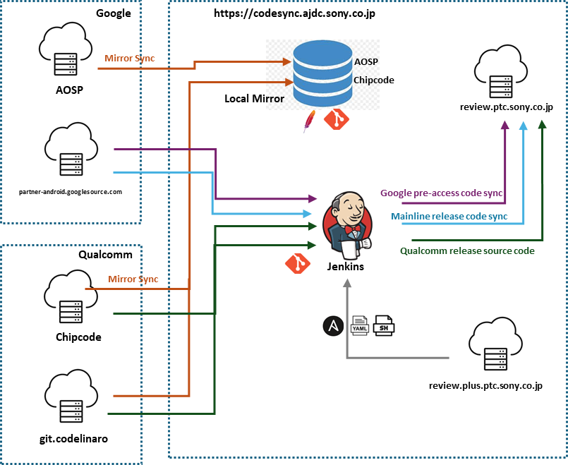

# CodeSync Jenkins Job Documentation

One page per CodeSync job (or job family, where many jobs share one template and differ only by values). Every page follows the same 8 sections:

1. Job Identification · 2. Purpose · 3. Trigger · 4. Parameters · 5. Expected Output · 6. **Output Validation (mandatory)** · 7. Failure & Troubleshooting History · 8. Recovery / Rerun

For the system overview, architecture and end-to-end runbooks, see [`../CodeSync_KT.md`](../CodeSync_KT.md). To document a new job, copy [`_TEMPLATE.md`](_TEMPLATE.md).



---

## Job index

| # | Job | Category | Source | Component | Criticality 🧭 | Trigger |
|---|---|---|---|---|---|---|
| 01 | [Update Mirror (repo-based, 6 jobs)](jobs/01-mirror-update-mirror.md) | Mirror Sync | AOSP / partner-android / Chipcode / Sony review | Local mirror | High | Scheduled |
| 02 | [Update Mirror Simple git.codelinaro.org](jobs/02-mirror-codelinaro-simple.md) | Mirror Sync | CodeLinaro | Local mirror | High | Scheduled ❓ |
| 03 | [Update Combined Mirror Manifest (2 jobs)](jobs/03-mirror-combined-manifest.md) | Mirror Sync | partner-android / review-plus | AML, FS, LE manifests | High / Normal | Scheduled ❓ → triggers mirror |
| 04 | [Sync Git (`sync_git_*`)](jobs/04-sync-git.md) | Git Sync | partner-android / AOSP | Single gits | Normal | Scheduled |
| 05 | [Sync Manifest & Gits (`sync_manifest_and_gits_ohd_*`)](jobs/05-sync-manifest-and-gits.md) | Manifest Sync | partner-android | AML prebuilt releases | High | Scheduled → `build_ohd_*` |
| 06 | [Sync Manifest (`sync_manifest_ohd_*`)](jobs/06-sync-manifest.md) | Manifest Sync | partner-android | Security / FS releases | High | Scheduled → `build_ohd_*` |
| 07 | [Import_Qcom_…_Kernel_…](jobs/07-import-qcom-kernel.md) | Vendor Import | Qualcomm (CLO) | Kernel | **Critical** | Manual |
| 08 | [Import_Qcom_…_QSSI…_… (+ standalone)](jobs/08-import-qcom-qssi.md) | Vendor Import | Qualcomm (Chipcode + CLO) | QSSI | **Critical** | Manual |
| 09 | [Import_Qcom_…_Vendor_techpack_…](jobs/09-import-qcom-vendor-techpack.md) | Vendor Import | Qualcomm (Chipcode + CLO) | Vendor Techpack | **Critical** | Manual ×2 (two-run) |
| 10 | [list_manifest_tags](jobs/10-list-manifest-tags.md) | Utility | Qualcomm + Sony | Kernel / QSSI / Vendor | Normal (import gate) | Manual ❓ |
| 11 | [Delete garbage files in EFS mirror](jobs/11-delete-garbage-files-efs-mirror.md) | Cleanup | Internal | `/mnt/efs/gitmirror` | Normal | Scheduled ❓ |
| 12 | [Delete stale repository in mirror (2 jobs)](jobs/12-delete-stale-repository-mirror.md) | Cleanup | Internal | Local mirror | Normal (destructive) | ❓ |
| 13 | [code_sync_deploy_jenkins_jobs](jobs/13-code-sync-deploy-jenkins-jobs.md) | Utility | review-plus `code-sync` | All job definitions | **Critical** | Webhook + nightly |
| 14 | [code_sync_test_jenkins_jobs](jobs/14-code-sync-test-jenkins-jobs.md) | Utility | review-plus `code-sync` | JJB validation | Normal | Webhook |

**Dependency chain:**
```
Mirrors (01, 02, 03) ──referenced by──► Sync Git (04) / Sync Manifest (05, 06) / Imports (07, 08, 09)
list_manifest_tags (10) ──go/no-go──► Imports (07, 08, 09)
code_sync_test (14) ──+1──► review ──merge──► code_sync_deploy (13) ──creates/updates──► all jobs
```

**Environments:** Prod `https://codesync.ptc.sony.co.jp/` (branch `master`, node `prod-code-sync`). Stage `https://codesync.ptc-stage.sony.co.jp/` (branch `stage`, node `stage-code-sync`). Job URLs follow `<base>/job/<job-id>/`. The job **ID** (used in the URL) can differ from the display name.

---

## Source legend

| Tag | Meaning |
|---|---|
| ✅ | Read from the `code-sync` checkout. ⚠️ **That checkout is an older snapshot** (branch `scps`, previous-generation import scripts). Schedules and names from it must be re-checked in Jenkins. |
| 📊 | `CodeSync_Jobs_ptc.pptx` |
| 🎙 | KT session transcripts (machine ASR; proper nouns may be garbled. **The PPT wins ties.**) |
| 🧭 | Proposed / operational judgement. **Criticality ratings are proposals. Confirm them with Sony.** |
| ❓ | Unconfirmed. Must be filled in from live Jenkins or the outgoing owner. |

---

## What still needs filling in (handover checklist)

These cannot be derived from the material in this folder. Fill them in from live Jenkins or from the outgoing owner:

- [ ] **Screenshots** (`📷` placeholders on every page): Jenkins *Build with Parameters* pages → save to `images/` with the suggested filename. The deck has no Jenkins screenshots. Only its 5 flow diagrams are reused here.
- [ ] **Job IDs and URLs** for 02, 03, 10, 11, 12 (not in the code checkout). Verify the derived IDs for the others.
- [ ] **Current cron schedules** for all scheduled jobs (🎙 re-spread after the Cloud J2 migration)
- [ ] **Current `Import_Qcom_*` job list** (the deck matrix stops at 2024-spf-1-0 / V-Shimanto)
- [ ] **Section 7 dates and Jira numbers.** Known incidents are listed without dates. The reference tickets are owed by the outgoing owner (KT §16.1).
- [ ] `list_manifest_tags` parameters; `SECURITY_PATCH_IMPORT` meaning; garbage-file pattern; `MISSING_SINCE` format
- [ ] Manual `repo init` procedure for the CodeLinaro mirror (nobody currently knows it)
- [ ] Which product uses `vendor_st` vs `vendor_techpack_st`
- [ ] The branch of the `sync_manifest_ohd_25Q4-fs-release` job (the deck says 25Q3)

**Keeping it current:** add every new incident to section 7 of the job's page (newest first) with its date and Jira ID, and update section 8 if the fix changed the recovery procedure.

---

## Images

| File | From | Used in |
|---|---|---|
| `images/architecture-slide04.png` | PPT slide 4 | this page |
| `images/import-components-slide06.png` | PPT slide 6 | 07, 09 |
| `images/mirror-sync-flow-slide11.png` | PPT slide 11 | 01 |
| `images/sync-manifest-flow-slide24.png` | PPT slide 24 | 05, 06 |
| `images/stale-repo-flow-slide32.png` | PPT slide 32 | 12 |
