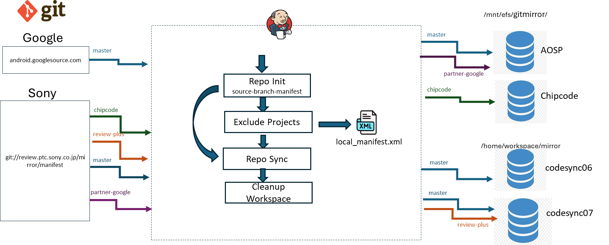

# Update Mirror (repo-based mirror jobs)

> **Scope:** the six `update_mirror_{name}_{node}` jobs that build and maintain the local git mirrors with `repo init --mirror` + `repo sync`. The CodeLinaro mirror works differently and has its own page: [02-mirror-codelinaro-simple.md](02-mirror-codelinaro-simple.md).
> **Sources:** ✅ `jenkins-jobs/template-mirroring.yaml`, `project-mirrors.yaml` (older checkout) · 📊 PPT slides 11–14 · 🎙 KT Session 1 · 🧭 proposed · ❓ unconfirmed
> **Background:** [CodeSync_KT.md §7](../../CodeSync_KT.md#7-mirror-sync-jobs)

---

## 1. Job Identification

| Field | Value |
|---|---|
| **Job Name** | One job per mirror (display name 📊 / job ID ✅ from the `update_mirror_{name}_{node}` template). See the instance table below. |
| **Job URL** | Prod: `https://codesync.ptc.sony.co.jp/job/<job-id>/` · Stage: `https://codesync.ptc-stage.sony.co.jp/job/<job-id>/` ❓ *confirm the job IDs in Jenkins. Old node suffixes are still in the names.* |
| **Category** | Mirror Sync |
| **Vendor / Source** | AOSP (`android.googlesource.com`), Google partner (`partner-android.googlesource.com`), Qualcomm Chipcode, Sony internal (`review`, `review-plus`) |
| **Component** | Local git mirror (`--reference` store for every sync and import job) |
| **Criticality** | 🧭 **High.** Imports and syncs keep working without the mirror, but much more slowly (🎙 the standalone-QSSI incident). Sync jobs also hit disk-space limits. |

**Instances** (📊 slides 12–13):

| Display name | Job ID (✅ template pattern) | Source URL | MIRROR_ROOT | Branch | Manifest | Sync args |
|---|---|---|---|---|---|---|
| Update Mirror android.googlesource.com on AOSP_MIRROR | `update_mirror_android.googlesource.com_AOSP_MIRROR` | `https://android.googlesource.com/mirror/manifest` | `/mnt/efs/gitmirror` | `main` | `default.xml` | `-j24` |
| Update Mirror chipcode.qti.qualcomm.com on CHIPCODE_MIRROR | `update_mirror_chipcode.qti.qualcomm.com_CHIPCODE_MIRROR` | `git://review.ptc.sony.co.jp/mirror/manifest` | `/mnt/efs/gitmirror` | `chipcode` | `external.xml` | `-j4 -f` |
| Update Mirror partner-android.googlesource.com on AOSP_MIRROR | `update_mirror_partner-android.googlesource.com_AOSP_MIRROR` | `git://review.ptc.sony.co.jp/mirror/manifest` | `/mnt/efs/gitmirror` | `partner-google` | `default.xml` | `-j12` |
| Update Mirror review-plus.ptc.sony.co.jp on codesync07 | `update_mirror_review-plus.ptc.sony.co.jp_codesync07` | `git://review.ptc.sony.co.jp/mirror/manifest` | `/home/code-sync/workspace/mirror` | `review-plus` | `default.xml` | `-j12` |
| Update Mirror review.ptc.sony.co.jp on codesync06 | `update_mirror_review.ptc.sony.co.jp_codesync06` | `git://review.ptc.sony.co.jp/mirror/manifest` | `/home/code-sync/workspace/mirror` | `master` | `default.xml` | `-j10 -t MAGIC-MIRROR` |
| Update Mirror review.ptc.sony.co.jp on codesync07 | `update_mirror_review.ptc.sony.co.jp_codesync07` | `git://review.ptc.sony.co.jp/mirror/manifest` | `/home/code-sync/workspace/mirror` | `master` | `default.xml` | `-j10 -t MAGIC-MIRROR` |

> 🎙 After the Cloud J2 migration every job runs on the single node `prod-code-sync` (prod) or `stage-code-sync` (stage). The `AOSP_MIRROR`, `CHIPCODE_MIRROR` and `codesync06/07` suffixes are **historical names**, not real nodes.

## 2. Purpose / Job Description

**What does this job actually do?**
It keeps a local, bare **mirror** of every git listed in a manifest. ✅ Each run does the following:
1. `cd $MIRROR_ROOT/<name>`
2. If `.repo/manifests.git` exists and `repo.mirror=true`, run `repo init` without `--mirror`. Otherwise run `rm -rf .repo` and `repo init … --mirror`. (🎙 This is the first-time vs. subsequent run difference.)
3. Write `EXCLUDED_PROJECTS` into `.repo/local_manifests/local_manifest.xml` as `<remove-project>` lines, or delete that file if the parameter is empty.
4. `repo sync $REPO_SYNC_ARGS`
5. `touch git-daemon-export-ok` in every `*.git` so the mirror can be served over `git://`.
6. 📊 Clean up temporary files older than one day.



**Why is this job required?**
The mirror is **not** where code is synced from. It is the `--reference` object store for every `repo init`. ✅ `config.sh` adds `--reference=$REPO_MIRROR` to `COMMON_REPO_INIT_ARGS`. Without the mirror, each sync or import job downloads the full history from the internet into its own workspace. That costs time for imports, and both time and disk space for sync jobs (🎙). For Qualcomm imports, the mirror must hold the needed upstream gits **before** the import runs, so `PSEUDO_MIRROR_TREE` can reference them.

> **Important:** the project list comes from **Sony's `mirror/manifest` git** (one branch per upstream), not from upstream. Only the AOSP mirror inits straight from Google. If new gits appear upstream, they are **not** mirrored until someone edits `mirror/manifest`. See §8.

## 3. Trigger Information

| Field | Value |
|---|---|
| **Trigger Type** | Scheduled (✅ `timed: '{trigger}'`) |
| **Schedule** | ✅ Older checkout: `H * * * *` (hourly) for AOSP and `review`; `H */2 * * *` (every 2 h) for Chipcode. 🎙 Schedules were re-spread after the Cloud J2 migration to avoid pile-ups on the 10 executors. ❓ **Read the current cron from each job's *Configure* page.** |
| **Manual Trigger Allowed?** | Yes |
| **When to trigger manually** | After a `mirror/manifest` change is merged (new gits); before a Qualcomm import if the mirror is behind; after a failed scheduled run that you want to confirm is transient |
| **Triggered by another job?** | `partner-android` mirror: 🎙 triggered by **`update_combined_mirror_manifest_partner-android.googlesource.com`** ([03](03-mirror-combined-manifest.md)). The others run on their timer. |
| **Downstream Jobs** | None formally. Every Sync Manifest, Sync Git and Qualcomm import job **references** the mirror at runtime. |

**Flow:**
```
mirror/manifest change (review) ─► Update Mirror ─► (referenced by) Sync Manifest / Sync Git / Import_Qcom_*
Upstream (Google / Chipcode) ────►      ▲
```

## 4. Job Parameters

> 📷 **Screenshot:** _add "Build with Parameters" for one mirror job_ → `../images/update-mirror-params.png`

| Parameter | Mandatory? | Example | Description | How to determine value | Risk if wrong |
|---|---|---|---|---|---|
| `SOURCE_URL` | Yes (defaulted) | `git://review.ptc.sony.co.jp/mirror/manifest` | Manifest git used for `repo init` | Job default. Only AOSP points at Google. | Mirror built from the wrong project list. Gits go missing or become extra. |
| `MIRROR_ROOT` | Yes (defaulted) | `/mnt/efs/gitmirror` | Parent directory of the mirror on disk | Job default. External mirrors use `/mnt/efs/gitmirror`. `review`/`review-plus` use `/home/code-sync/workspace/mirror`. | Builds a **second, empty mirror** elsewhere: hours of download, disk fills up, and jobs keep pointing at the stale one |
| `BRANCH` | Yes (defaulted) | `chipcode` | Branch of `mirror/manifest` | Matches the upstream name (`chipcode`, `partner-google`, `review-plus`, `master`, `main`) | Mirrors a different upstream's project list |
| `MANIFEST` | Yes (defaulted) | `external.xml` | `default.xml` (internal fetch URL) or `external.xml` (real upstream fetch URL) | ✅ Generated pair: same projects, different `fetch=` | Syncing from itself (`default.xml` on an external mirror) or from the wrong host |
| `REPO_SYNC_ARGS` | Yes (defaulted) | `-j4 -f` | Arguments passed to `repo sync` | Job default. Lower `-j` for huge gits. `-f` = keep going past failures. | Too high `-j` overloads the upstream or node. Dropping `-f` means one bad git fails the whole run. |
| `EXCLUDED_PROJECTS` | No | `platform/foo platform/bar` | Projects to skip (whitespace-separated) | Only when a git is known to be broken or removed upstream | Excluding a needed git means imports lose the reference and run slowly. Leaving it empty **deletes** any earlier exclusion. |

## 5. Expected Output

- The mirror directory `$MIRROR_ROOT/<name>/` holds an up-to-date bare clone of **every project in the mirror-manifest branch**
- New upstream commits, branches and tags are present in the mirror
- New gits that were just added to `mirror/manifest` now exist as `<project>.git` directories
- Every `*.git` carries `git-daemon-export-ok`
- `.repo/local_manifests/local_manifest.xml` matches `EXCLUDED_PROJECTS` (present or absent)
- Temporary files older than one day have been removed
- Console log ends after `repo sync` with no `error: Cannot fetch` lines (or only known transient ones)

## 6. Output Validation / Success Criteria (Mandatory)

### Level 1: Jenkins
- Status **SUCCESS**
- The console shows `repo init` without `--mirror` (a normal run). If you see `rm -rf .repo` followed by `--mirror`, the job **rebuilt the mirror from scratch**. Find out why.
- `repo sync` completes. Scan for `error:`, `fatal:`, `Cannot fetch`, `503`.
- 🎙 Chipcode mirror: occasional fetch errors on a **different** git each run are normal. The **same** git failing repeatedly is not normal (see §7).

### Level 2: Git / Mirror
On the code-sync node:
```bash
cd /mnt/efs/gitmirror/<name>                       # or /home/code-sync/workspace/mirror/<name>
git --git-dir .repo/manifests.git config --local repo.mirror     # expect: true
repo list | wc -l                                  # compare with project count in mirror/manifest
# freshness of one representative git vs upstream:
git --git-dir <project>.git rev-parse refs/heads/<branch>
git ls-remote <upstream-url>/<project> refs/heads/<branch>        # SHA-1s should match
ls <project>.git/git-daemon-export-ok
```

### Level 3: Manifest
```bash
git ls-remote git://review.ptc.sony.co.jp/mirror/manifest refs/heads/<BRANCH>
git --git-dir .repo/manifests.git log -1 --format='%H %ci %s'    # mirror is at the latest manifest commit
```
If you just merged a `mirror/manifest` change, confirm the new `<project>` entries now exist on disk as `.git` directories.

### Level 4: Sync validation
Run a consumer that uses the mirror as a reference and check that it only fetches the delta:
```bash
repo init -u <manifest> -b <branch> --reference=/mnt/efs/gitmirror/<name>
repo sync -c -j8
cat .repo/projects/<project>.git/objects/info/alternates   # points into the mirror
```
For imports: after the next `Import_Qcom_*` run with `PSEUDO_MIRROR_TREE` enabled, `git_start.html` should show `repo_mirror_location` under the workspace mirror path (🎙).

## 7. Failure & Troubleshooting History

| Date | Error / Symptom | Root Cause | Identification | Fix / Recovery | Jira | Preventive Action |
|---|---|---|---|---|---|---|
| ❓ recurring | Chipcode / CodeLinaro mirror: fetch failures on large gits (`index invalid packet`, socket errors) | Network-bound sync of very large gits (🎙 transient) | Console log. A **different** git fails each time. | No action. The next scheduled run usually passes. | ❓ owed (KT §16.1 #1) | 🧭 Only alert if 3+ consecutive failures |
| ❓ | Same git fails on every run | Git removed or renamed upstream | Console log, same project each time | 🎙 `git ls-remote <url>` → rerun `repo init`/`sync` for that project with `GIT_TRACE=1 GIT_TRACE2=1 repo -v` → check the Qualcomm/CLO account → **then** raise a ticket to Sony (Onishi-san / Yuko-san) to drop it from `mirror/manifest` | ❓ | Do the troubleshooting **before** escalating |
| ❓ | New upstream gits are not in the mirror. Import runs very slowly. | `mirror/manifest` not updated for a new platform | Import log / `git_start.html`. Project missing under `MIRROR_ROOT`. | Patch `mirror/manifest` (branch `chipcode` etc.) → review → merge → trigger this job | ❓ owed (KT §16.1 #3) | 🧭 Add a "new gits in mirror?" check to the import checklist |
| ❓ (KT Session 1) | Job labelled with a node it should not be on | Stale node name left over from the SCPS era | Job config | Agreed it can be corrected through a patch | — | Treat node suffixes as historical |

> 📝 Add new incidents at the top. Fill in **Date** and **Jira** from the ticket. Do not leave them as ❓ once known.

## 8. Recovery / Rerun Procedure

**Is rerun safe?** **Yes.** The job only fetches into the mirror and never pushes to the review server. A rerun simply continues the `repo sync`.

**Before rerun check:**

| Check | How |
|---|---|
| Was the upstream source available? | `git ls-remote <SOURCE_URL>` and `git ls-remote <upstream>/<failing-project>` |
| Did the previous build partially push anything? | N/A. Mirror jobs do not push. |
| Is the Jenkins workspace clean? | Not relevant. The work happens in `MIRROR_ROOT`, not the workspace. Check for a stale `.repo/*.lock` or `index.lock` left by a killed run. |
| Is another CodeSync job running against the same repository? | Make sure no other build of **this** mirror job is running (two `repo sync` runs into the same mirror corrupt it). Imports **reading** the mirror are fine. |
| Does anything need rollback or cleanup? | Only if the console shows an unexpected `rm -rf .repo` + `--mirror` re-init. In that case let it finish; the first full sync takes hours. |
| Has the Qualcomm import script changed? / Does the script need adapting for a new branch or tag? | Not applicable to the script. The equivalent here: **does `mirror/manifest` need new `<project>` entries?** If so, patch it first (🎙 code-review flow, not a job trigger). |
| Should an obsolete branch be moved aside? | Not applicable. For a git **removed** upstream, add it to `EXCLUDED_PROJECTS` temporarily and ask Sony to remove it from `mirror/manifest`. |

**Rerun steps:**
1. Read the console. Classify the failure as transient (different git each time) or persistent (same git).
2. Transient: trigger *Build Now* with default parameters.
3. Persistent: follow the triage in §7, row 2. Optionally rerun with that project in `EXCLUDED_PROJECTS` to unblock the rest of the mirror.
4. Confirm Level 1–2 checks.
