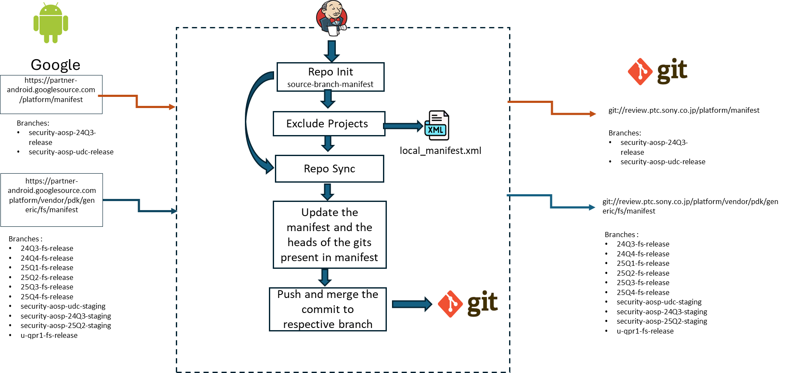

# Sync Manifest & Gits jobs (`sync_manifest_and_gits_ohd_*`)

> **Sources:** ✅ `ohd.sh`, `template-sync.yaml` (older checkout) · 📊 PPT slides 20–22 · 🎙 KT Session 2 · 🧭 proposed · ❓ unconfirmed
> **Background:** [CodeSync_KT.md §9](../../CodeSync_KT.md#9-sync-manifest-and-sync-manifestgits-jobs). The sister job type is [06-sync-manifest.md](06-sync-manifest.md).

---

## 1. Job Identification

| Field | Value |
|---|---|
| **Job Name** | `sync_manifest_and_gits_ohd_<branch>`. Instances: `t-aml-prebuilt-release`, `t-go-aml-prebuilt-release`, `u-aml-prebuilt-release`, `v-aml-prebuilt-release`, `b-aml-prebuilt-release` (📊 slide 22) |
| **Job URL** | Prod: `https://codesync.ptc.sony.co.jp/job/sync_manifest_and_gits_ohd_<branch>/` |
| **Category** | Manifest Sync |
| **Vendor / Source** | Google partner: `https://partner-android.googlesource.com` (`platform/manifest`) |
| **Component** | AOSP / Android Mainline (AML) prebuilt release branches |
| **Criticality** | 🧭 **High.** It feeds mainline module prebuilts into Sony builds and triggers `build_ohd_<branch>`. |

## 2. Purpose / Job Description

**What does this job actually do?**
📊 It downloads the latest manifest for the branch, syncs every git in it, pushes the changes to `review.ptc.sony.co.jp`, branches out any gits that are not branched yet, and **also fetches and pushes all tags** for each git in `static_manifest.xml`. ✅ The logic is `ohd.sh` with `PUSH_MODE=all`:
1. `repo init --mirror` + `repo sync` of the upstream manifest into `ohd/` (using the AOSP/partner mirror as a reference)
2. `ensure-projects-exist.sh` creates any missing projects on review under `admin/meta/android-standard`
3. For each project, pushes **every local branch containing the manifest revision** to `refs/heads/ohd/<br>` (plus `builds/<branch>/*` for the manifest git)
4. Pushes the manifest branch to `ohd/<branch>` and builds `semc/ohd/<branch>`, the **internal manifest** rewritten to point at Sony's Gerrit
5. Emits `static_manifest.xml` and `manifest_revision`. The build description is `NONEW` or the SW label.



**Why is this job required?**
Sony products build against mainline (AML) prebuilt releases. Builds must fetch from Sony's gated Gerrit, never from Google directly, and the module **tags** must be present.

## 3. Trigger Information

| Field | Value |
|---|---|
| **Trigger Type** | Scheduled (✅ `timed`) |
| **Schedule** | ❓ Per job. Read it from *Configure*. (✅ Older partner jobs used `H */6`, `H */2` and `H * * * *`.) |
| **Manual Trigger Allowed?** | Yes |
| **When to trigger manually** | A consumer needs a just-published AML release now; after a failed run; after the combined mirror gets a new branch |
| **Triggered by another job?** | No |
| **Downstream Jobs** | ✅ `build_ohd_<branch>` (on SUCCESS). Email to `somc-cmtool-admin@sony.com` (✅ defaults). |

**Flow:** `partner-android (AML branch) → [combined mirror] → sync_manifest_and_gits_ohd_<branch> → review.ptc.sony.co.jp → build_ohd_<branch>`

## 4. Job Parameters

> 📷 **Screenshot:** _add "Build with Parameters"_ → `../images/sync-manifest-and-gits-params.png`

| Parameter | Mandatory? | Example | Description | How to determine value | Risk if wrong |
|---|---|---|---|---|---|
| `MANIFEST` | Yes (defaulted) | `platform/manifest` | Upstream manifest git | Job default | Wrong release synced |
| `BRANCH` | Yes (defaulted) | `u-aml-prebuilt-release` | Upstream manifest branch, or `tag` | Job default | Wrong release pushed to `ohd/<branch>` |
| `TAG` | Conditional | `android-7.1.1_r4` | Used only when `BRANCH=tag` | Upstream tag list | — |
| `REMOTE` | Yes | `ohd` | Namespace on the Sony side | Always `ohd` | Refs land in an unexpected namespace |
| `SKIP_PUSH` | No | `False` | Dry run: sync without pushing | `True` only when testing | Left `True` in prod means nothing is pushed while the job still succeeds |
| `SKIP_SYNC` | No | `False` | Skip the upstream sync | `False` | Pushes stale content |
| `SOURCE_GERRIT` | Yes (defaulted) | `https://partner-android.googlesource.com` | Upstream host | Job default | — |
| `REPO_INIT_ARGS` | No | *(blank)* | Extra `repo init` arguments | Job default | — |
| `REPO_FORALL_ARGS` | No | `-j20` | Parallelism for `repo forall` | Job default | Overloads Gerrit |
| `PUSH_MODE` | Yes | `all` | `single` / `all` / `tag` (✅ see KT §9.2) | `all` for this family | `single` misses non-default branches |
| `GIT_PUSH_ARGS` | No | `--force -o skip-validation` | Extra push arguments | Job default | Without `skip-validation`, Gerrit may reject large pushes |
| `EXCLUDED_PROJECTS` | No | *(blank)* | Projects to skip | Only for broken upstream gits | Consumers miss a project |

## 5. Expected Output

- `refs/heads/ohd/<branch>` on `platform/manifest` (review) = upstream branch head
- `refs/heads/semc/ohd/<branch>` updated with the internal-adapted manifest ("Adapted revision for internal use")
- All project branches containing the manifest revision pushed to `ohd/*`. **All tags** pushed.
- New upstream gits created on review automatically (`ensure-projects-exist.sh`)
- Artifacts: `result-dir/static_manifest.xml`, `result-dir/manifest_revision`
- Build description: **SW label** (new content) or **`NONEW`** (nothing changed)
- `build_ohd_<branch>` triggered

## 6. Output Validation / Success Criteria (Mandatory)

### Level 1: Jenkins
- **SUCCESS**. Build description is a label or `NONEW`. The downstream `build_ohd_<branch>` was triggered.
- Console: no `rejected` or `fatal:`. A `repo sync` retry after `rm -rf` is normal (✅ built-in retry). Two failures in a row are not.

### Level 2: Git / Mirror
```bash
git ls-remote https://partner-android.googlesource.com/platform/manifest refs/heads/<branch>
git ls-remote git://review.ptc.sony.co.jp/platform/manifest refs/heads/ohd/<branch>   # same SHA-1
git ls-remote git://review.ptc.sony.co.jp/platform/manifest refs/heads/semc/ohd/<branch>
# spot-check a project + tag from static_manifest.xml
git ls-remote --tags git://review.ptc.sony.co.jp/<project> | grep <expected-tag>
```

### Level 3: Manifest
Download `static_manifest.xml` from the build artifacts. Diff it against the previous build's copy (the job does this itself and sets `NONEW` when they are identical). The `semc/ohd/<branch>` `default.xml` should show `remote="origin"`, `review="https://review.ptc.sony.co.jp"`, revisions prefixed `ohd/`, and no `clone-depth`.

### Level 4: Sync validation
```bash
repo init -u git://review.ptc.sony.co.jp/platform/manifest -b semc/ohd/<branch>
repo sync -c -j8          # must complete with no missing revisions
```

## 7. Failure & Troubleshooting History

| Date | Error / Symptom | Root Cause | Identification | Fix / Recovery | Jira | Preventive Action |
|---|---|---|---|---|---|---|
| ❓ recurring | `repo sync` failure | Upstream or network | Console (the job already retries once from clean) | Rerun | — | — |
| 🧭 risk | Branch retired upstream, job keeps failing or syncing nothing | Release branch dropped | `NONEW` forever, or a missing-branch error | Remove the job **and** the branch in the combined mirror job ([03](03-mirror-combined-manifest.md)) | — | Two-place retirement rule |

## 8. Recovery / Rerun Procedure

**Is rerun safe?** **Yes.** `ohd.sh` only pushes what is missing on the server, to the `ohd/*` and `semc/ohd/*` namespaces.

**Before rerun check:**

| Check | How |
|---|---|
| Was the upstream source available? | `git ls-remote $SOURCE_GERRIT/$MANIFEST refs/heads/$BRANCH` |
| Did the previous build partially push anything? | Possibly some projects. The rerun pushes the rest. Harmless. |
| Is the Jenkins workspace clean? | Not required. The job reuses `repo/ohd` and `repo/ref` for speed. If the workspace is corrupt, use *Wipe Out Current Workspace* (the next run is slower). |
| Is another CodeSync job running against the same repository? | Make sure no other build of the same branch job is running |
| Does anything need rollback or cleanup? | No, unless the wrong `BRANCH` was pushed. Ask Sony CM to delete the wrongly created `ohd/<branch>` refs. |
| Does the script need adapting for a new branch or tag? | New branch = new job entry plus a combined-mirror entry (patch). `ohd.sh` itself does not change. |
| Should an obsolete branch be moved aside? | Only on a non-fast-forward to `semc/ohd/<branch>`. Back it up as `semc/ohd/<branch>-obsolete-<date>` using the service account, then rerun. Agree with Sony first. |

**Rerun steps:** *Build Now* (defaults) → Level 2 → Level 4 if a consumer reported an issue.
