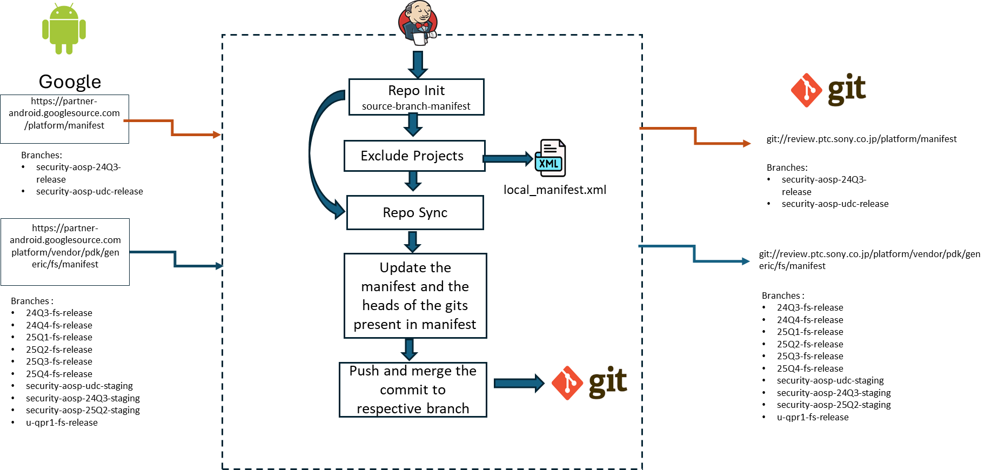

# Sync Manifest jobs (`sync_manifest_ohd_*`)

> **Sources:** ✅ `ohd.sh`, `template-sync.yaml` (older checkout) · 📊 PPT slides 23–26 · 🎙 KT Session 2 · 🧭 proposed · ❓ unconfirmed
> **Background:** [CodeSync_KT.md §9](../../CodeSync_KT.md#9-sync-manifest-and-sync-manifestgits-jobs). The script logic is shared with [05-sync-manifest-and-gits.md](05-sync-manifest-and-gits.md). This page covers the differences.

---

## 1. Job Identification

| Field | Value |
|---|---|
| **Job Name** | `sync_manifest_ohd_<branch>`. Instances below. |
| **Job URL** | Prod: `https://codesync.ptc.sony.co.jp/job/sync_manifest_ohd_<branch>/` |
| **Category** | Manifest Sync |
| **Vendor / Source** | Google partner: `https://partner-android.googlesource.com` |
| **Component** | AOSP security branches; Google pre-access **FS release** branches |
| **Criticality** | 🧭 **High.** Security-patch and pre-access code feeds product builds. |

**Instances** (📊 slides 25–26):

| Job | Manifest | Push mode | Repo init args |
|---|---|---|---|
| `sync_manifest_ohd_security-aosp-udc-release` | `platform/manifest` | `single` | |
| `sync_manifest_ohd_security-aosp-24Q3-release` | `platform/manifest` | `single` | |
| `sync_manifest_ohd_24Q4-fs-release` | `platform/vendor/pdk/generic/fs/manifest` | `all` | `--repo-rev=rel/v2.51 --no-current-branch` |
| `sync_manifest_ohd_25Q2-fs-release` | ″ | `all` | ″ |
| `sync_manifest_ohd_25Q3-fs-release` | ″ | `all` | ″ |
| `sync_manifest_ohd_25Q4-fs-release` | ″ | `all` | ″ ❓ *the deck shows branch `25Q3-fs-release`, probably a typo. Verify.* |
| `sync_manifest_ohd_security-aosp-udc-staging` | `platform/vendor/pdk/generic/fs/manifest` | `single` | |
| `sync_manifest_ohd_security-aosp-24Q3-staging` | ″ | `single` | |
| `sync_manifest_ohd_security-aosp-25Q2-staging` | ″ | `single` | |

**Pattern:** `security-*` → `PUSH_MODE=single`. `*-fs-release` → `PUSH_MODE=all` and a pinned repo tool version.

## 2. Purpose / Job Description

**What does this job actually do?**
📊 It downloads the latest manifest for a branch, syncs every git, pushes and merges changes to `review.ptc.sony.co.jp`, and branches out any gits that are not branched yet. ✅ `ohd.sh` (same phases as [05](05-sync-manifest-and-gits.md#2-purpose--job-description)). The difference from *Manifest & Gits* is that this job does **not** push all tags of every git.

- `single` mode: each project's `HEAD` → `refs/heads/ohd/<branch>`, **only if** the server doesn't already have that revision. When the previous `ref/` tree exists, it compares against that local tree instead of the server (faster).
- `all` mode: every branch containing the manifest revision → `ohd/<br>`



**Why is this job required?**
🎙 Three branch families need to reach Sony's Gerrit: **security** branches (monthly security patches), **FS release** branches (pre-access code), and AML (handled by [05](05-sync-manifest-and-gits.md)).

## 3. Trigger Information

| Field | Value |
|---|---|
| **Trigger Type** | Scheduled (✅ `timed`) |
| **Schedule** | ❓ Per job. Read it from *Configure*. |
| **Manual Trigger Allowed?** | Yes |
| **When to trigger manually** | A new security-patch drop or FS release is announced and needed now; after a failure |
| **Triggered by another job?** | No |
| **Downstream Jobs** | ✅ `build_ohd_<branch>` (on SUCCESS, label suffix parsed from the PDK manifest commit message for FS manifests); email |

**Flow:** `partner-android (security / FS branch) → sync_manifest_ohd_<branch> → review.ptc.sony.co.jp → build_ohd_<branch>`

## 4. Job Parameters

> 📷 **Screenshot:** _add "Build with Parameters"_ → `../images/sync-manifest-params.png`

| Parameter | Mandatory? | Example | Description | How to determine value | Risk if wrong |
|---|---|---|---|---|---|
| `MANIFEST` | Yes (defaulted) | `platform/vendor/pdk/generic/fs/manifest` | Upstream manifest git | Job default (see table) | Wrong release synced |
| `BRANCH` | Yes (defaulted) | `25Q2-fs-release` | Upstream branch | Job default. **Check the 25Q4 job.** | Wrong release pushed to `ohd/<branch>` |
| `TAG` | Conditional | `android-7.1.1_r4` | Used when `BRANCH=tag` | — | — |
| `REMOTE` | Yes | `ohd` | Sony-side namespace | Always `ohd` | — |
| `SOURCE_GERRIT` | Yes (defaulted) | `https://partner-android.googlesource.com` | Upstream host | Job default | — |
| `REPO_INIT_ARGS` | Conditional | `--repo-rev=rel/v2.51 --no-current-branch` | Pins the repo tool version (FS manifests) | Job default for `*-fs-release` | Newer repo tools fail on these manifests (🧭 likely the reason for the pin) |
| `REPO_FORALL_ARGS` | No | `-j20 -v` | `repo forall` parallelism and verbosity | Job default | — |
| `PUSH_MODE` | Yes | `single` / `all` | See §2 | Per the family pattern | `single` on FS misses branches. `all` on security pushes unnecessary branches. |
| `GIT_PUSH_ARGS` | No | per job | Extra push arguments | Job default | — |
| `EXCLUDED_PROJECTS` | No | *(blank)* | Projects to skip | Only for broken upstream gits | Consumers miss a project |
| `SECURITY_PATCH_IMPORT` | ❓ | ❓ | 📊 Present on Sync Manifest jobs. Meaning not explained in the sessions. | ❓ Ask | ❓ |

## 5. Expected Output

- `platform/manifest` (or the FS manifest) on review: `ohd/<branch>` = upstream head, and `semc/ohd/<branch>` = internal-adapted manifest
- Changed projects pushed to `ohd/<branch>` (single) or `ohd/*` (all)
- New upstream gits created on review automatically
- Artifacts `static_manifest.xml` and `manifest_revision`. Description: SW label or `NONEW`.
- `build_ohd_<branch>` triggered

## 6. Output Validation / Success Criteria (Mandatory)

### Level 1: Jenkins
- **SUCCESS**. Description: label or `NONEW`. Downstream build triggered.
- No `rejected` or `fatal:`. At most one `repo sync` retry.

### Level 2: Git / Mirror
```bash
git ls-remote $SOURCE_GERRIT/$MANIFEST refs/heads/$BRANCH
git ls-remote git://review.ptc.sony.co.jp/$MANIFEST refs/heads/ohd/$BRANCH            # same SHA-1
git ls-remote git://review.ptc.sony.co.jp/$MANIFEST refs/heads/semc/ohd/$BRANCH
# security branches: spot-check a patched project
git ls-remote git://review.ptc.sony.co.jp/<project> refs/heads/ohd/$BRANCH
```

### Level 3: Manifest
Compare `static_manifest.xml` with the previous build. For a security drop, confirm the projects named in the security bulletin changed revision.

### Level 4: Sync validation
```bash
repo init -u git://review.ptc.sony.co.jp/$MANIFEST -b semc/ohd/$BRANCH [--repo-rev=rel/v2.51]
repo sync -c -j8
```

## 7. Failure & Troubleshooting History

| Date | Error / Symptom | Root Cause | Identification | Fix / Recovery | Jira | Preventive Action |
|---|---|---|---|---|---|---|
| ❓ | 25Q4 job may be syncing the 25Q3 branch | Possible copy-paste in config (deck shows it) | Job *Configure* → `BRANCH` | Fix by patch if confirmed | ❓ | Verify on handover |
| ❓ recurring | `repo sync` failure | Network | Console | Rerun | — | — |

## 8. Recovery / Rerun Procedure

**Is rerun safe?** **Yes.** Pushes are additive and only go to the `ohd/*` and `semc/ohd/*` namespaces.

**Before rerun check:** same as [05 §8](05-sync-manifest-and-gits.md#8-recovery--rerun-procedure). Additionally:
- For `single` mode, if the previous run left a corrupted `ref/` tree, the job compares against wrong data and may **skip** pushes. Wipe the workspace to force a comparison against the live server.

**Rerun steps:** *Build Now* → Level 2 check.
