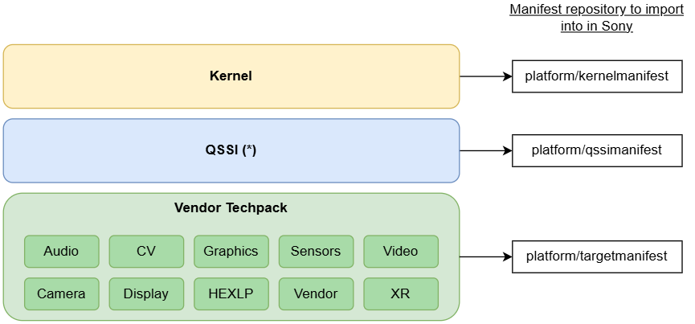

# Import_Qcom_<distro>_Kernel_<project>

> **Sources:** 📊 PPT slides 5–9 · 🎙 KT Sessions 3–5 · 🧭 proposed · ❓ unconfirmed. **The current import scripts are not in the code checkout**, so this page has no line references. Stage names come from the PPT SmartArt.
> **Background:** [CodeSync_KT.md §10](../../CodeSync_KT.md#10-qualcomm-import-jobs), [§12 Runbook](../../CodeSync_KT.md#12-runbook-performing-a-qualcomm-import), [§13 Verification](../../CodeSync_KT.md#13-runbook-verification)

---

## 1. Job Identification

| Field | Value |
|---|---|
| **Job Name** | `Import_Qcom_<distro>_Kernel_<project>`. 📊 Examples: `Import_Qcom_2024-spf-1-0_Kernel_V-Shimanto`, `Import_Qcom_2023-spf-2-0_Kernel_V-Asahi`, `…_U-Asahi`, `…_V-Yodo`, `…_U-Yodo`, `…_T-Yodo`. ❓ Newer platforms (Yamamoto etc.) are missing from the deck. **Use Jenkins for the current list.** |
| **Job URL** | Prod: `https://codesync.ptc.sony.co.jp/job/Import_Qcom_<distro>_Kernel_<project>/` · Stage (testing with volatile branch + test tag): `https://codesync.ptc-stage.sony.co.jp/job/…/` |
| **Category** | Vendor Import |
| **Vendor / Source** | Qualcomm: CodeLinaro (`git.codelinaro.org`) for the kernel. 🎙 **Kernel has no Chipcode entry.** |
| **Component** | Kernel → Sony manifest `platform/kernelmanifest` |
| **Criticality** | 🧭 **Critical.** It changes Sony's kernel reference branch and tags that product builds consume. |



## 2. Purpose / Job Description

**What does this job actually do?**
It imports one Qualcomm kernel release (one **AU tag**) into Sony's review server. It downloads the tree into `kernel_st/`, pushes every project, then builds Sony's reference tree in `ref_st/`, pins `REF_BRANCH` to the release, and tags every project with `$AU_TAG`. There are 10 stages (📊 slides 8–9):

| # | Stage | What it does |
|---|---|---|
| 1 | `prepare_utilities` | Sparse-checkout `sync_snap_v2.sh` (and `snap_release.xml` on the newest platforms) from distro git |
| 2 | `syncsnap` | Download the whole tree with `sync_snap_v2.sh`. Set the mirror location. Build the pseudo mirror if enabled. |
| 3 | `syncsnap-notdefault` | Sync the `notdefault`-group repositories |
| 4 | `syncsnap-list` | List the downloaded repos (`gits.txt`) and generate the combined manifest |
| 5 | `syncsnap-push` | Create new projects on review. Push every project, filtered by remote pattern. **Apply project-name rewrites.** |
| 6 | `hy11` | Commit the prebuilt directory into its dedicated git and push |
| 7 | `ref-manifest` | Join the local manifests → `$AU_TAG.xml`. Push it to `grease/$AU_TAG.xml` in the manifest git. |
| 8 | `ref-repo-init` / `ref-repo-sync` | Download the whole tree **from Sony's review server** |
| 9 | `ref-push` | Pin `refs/heads/$REF_BRANCH` of every project to the defined revision |
| 10 | `ref-tag` | Generate `default.xml`. Tag every project `$AU_TAG` (`tag-official-release.py`). |

**Kernel-specific rewrites** (🎙): `platform/external/dtc` → `…dtc-kernel`, and the **cuttlefish** project gets a suffix too. Both also exist in QSSI with different content.

**Why is this job required?**
Sony product kernels are built from `platform/kernelmanifest` on `REF_BRANCH`. Each Qualcomm kernel release must land there, fully tagged, so product teams can integrate it.

## 3. Trigger Information

| Field | Value |
|---|---|
| **Trigger Type** | **Manual** |
| **Schedule** | None |
| **Manual Trigger Allowed?** | Yes, and it is the only way to run it |
| **When to trigger manually** | A new Qualcomm release for one of Sony's distros (`… AMSS Standard OEM`) is published **and** `list_manifest_tags` shows the new kernel tag on **CodeLinaro** (kernel: CLO only), **and** the parameter set has been peer-reviewed in the team channel |
| **Triggered by another job?** | No |
| **Downstream Jobs** | None automatic. 🎙 The import-completion email or notification job is ❓ unverified. Consuming product teams integrate from `REF_BRANCH`. |

**Flow:**
```
Qualcomm release email / QPM ─► list_manifest_tags (CLO has tag?) ─► [Update Mirror Simple git.codelinaro.org]
      ─► Import_Qcom_*_Kernel_* ─► review: platform/kernelmanifest @ REF_BRANCH + tag AU_TAG ─► completion email
```
Kernel, QSSI and Vendor Techpack imports for the same release **can run in parallel** (separate workspaces).

## 4. Job Parameters

> 📷 **Screenshot:** _add "Build with Parameters" for one kernel import job_ → `../images/import-kernel-params.png`

| Parameter | Mandatory? | Example | Description | How to determine value | Risk if wrong |
|---|---|---|---|---|---|
| `AU_TAG` | **Yes** | `AU_LINUX_KERNEL.…` | Qualcomm release tag to import | Release note, "Android build information" table, **kernel** row. Cross-check with `list_manifest_tags` (CLO) and the published clone command or the last 3 digits of the release number. | **Wrong software imported** and tagged on Sony's branch |
| `AU_TAG_INTERNAL` | No | `test_01_<AU_TAG>` | Test tag used instead of the real tag (with a volatile branch, on stage) | Only for testing | A test tag in prod leaves projects untagged with the real tag |
| `RELEASE_NUMBER` | **Yes** | full release number | Vendor release | Release email or note | Import mismatch with the release note. Wrong script path. |
| `REF_BRANCH` | **Yes** (defaulted) | Sony kernel ref branch | Branch pinned in stage 9 | Job default (agreed with Sony per job). A **volatile** branch only if the release is behind the ref branch. | **Wrong branch updated.** Product kernel moved to the wrong release. |
| `SYNC_SCRIPT` | Yes (defaulted) | `distro git` | Source of `sync_snap_v2.sh` | `distro git`. `local` only for debugging. | Stale or unreviewed download script |
| `SKIP_STAGES_BEFORE` | No | `ref-tag` | Resume from this stage | Blank for a fresh run. The failed stage name when resuming. | ⚠️ With `CLEANUP_WORKING_DIR` checked, the workspace is wiped and the skipped stages' output is lost. **The job only warns.** |
| `STOP_BUILD_AT_STAGE` | No | *(blank)* | Halt after this stage | Blank for kernel | Import stops half-way, with a "successful" partial run |
| `CLEANUP_WORKING_DIR` | Conditional | ✅ checked | Wipe the workspace first | Checked for a fresh run. **Unchecked when resuming.** | Stale files (checked=no on a fresh run), or a wiped resume (checked=yes with skip) |
| `PSEUDO_MIRROR_TREE` | No | ✅ enabled | Build a symlinked mirror in the workspace and reference it | Enabled, unless the mirror path is known broken (public↔private move) | Disabled = much slower. Enabled with a wrong path = failure. |
| `GIT_PUSH_ARGS` | No | *(blank)* / `--dry-run` | Extra push arguments | Blank in prod | `--dry-run` left in prod pushes nothing |
| `VERBOSE_QCOM_SYNC` | No | unchecked | `GIT_TRACE=1` etc. | Enable when debugging download failures | Huge logs |
| `SYNC_SNAP_OPTS` / `PRESYNC_COMMANDS` | No | *(blank)* | Extra download options / pre-sync commands | 🎙 Never used so far | — |
| `TEMP_PROXY` | No | *(blank)* | Legacy | Unused (server proxy is configured) | — |
| `USE_LOCAL_SCRIPTS` | No | unchecked | Overlay local scripts | Leave unchecked in prod. Test on stage instead. | Unreviewed code in prod |
| `SENSOR_TAG` `XR_TAG` `HEXLP_TAG` `GRAPHICS_TAG` `WLAN_TAG` `BFTM_TAG` | No | *(blank)* | Techpack tags. Not used for kernel. | — | — |

**Project/template variables** (set in `project-qcom-<product>.yaml`, not at build time): `distro`, `tree_type=kernel`, `hy11_suffix=-kernel`, `ref_branch`, `manifest_branch`, `caf_remote_suffix` (`private` while the OSS manifest is private, **removed** when public), `oss_manifest`, `path_to_sync_script_dir`, `chipcode_customer_id=1055`, `gerrit_user=JP21771`, `workspace=kernel_st`. See [KT §10.5](../../CodeSync_KT.md#105-project--and-template-level-variables).

## 5. Expected Output

- Every kernel project from the release pushed to `review.ptc.sony.co.jp` (new projects auto-created)
- `platform/external/dtc` landed as **`…dtc-kernel`**, and **cuttlefish** with its kernel suffix
- Prebuilt (`prebuilt-hy11-kernel`) git committed and pushed
- `grease/$AU_TAG.xml` committed to `platform/kernelmanifest`
- `refs/heads/$REF_BRANCH` of every project pinned to the release revision
- **Every project tagged `$AU_TAG`**. `default.xml` on `REF_BRANCH` regenerated for the release.
- Workspace artifacts: `gits.txt` / HTML list, `project_list.xml`, `git_start.html`, combined manifest
- Import lock for `kernel_st` released

## 6. Output Validation / Success Criteria (Mandatory)

### Level 1: Jenkins
- **SUCCESS**, last stage **`ref-tag`** completed
- **Tag counters** (from the `ref-tag` log): `tag OK` + `tag exists` = every project, **`failed = 0`**. On a resumed run, earlier projects show as `tag exists`.
- No unexpected `error:`/`fatal:`/`rejected`. Network noise in `syncsnap` that was retried successfully is acceptable.
- No "lock held by <job>" message

### Level 2: Git / Mirror
```bash
# tag on the manifest git and on key projects
git ls-remote --tags git://review.ptc.sony.co.jp/platform/kernelmanifest  "$AU_TAG"
git ls-remote --tags git://review.ptc.sony.co.jp/kernel/common            "$AU_TAG"
# name-rewrite checks
git ls-remote git://review.ptc.sony.co.jp/platform/external/dtc-kernel refs/tags/$AU_TAG   # exists
# ref branch moved
git ls-remote git://review.ptc.sony.co.jp/kernel/common refs/heads/$REF_BRANCH
```
🎙 Spot-check on the review UI: pick `kernel/common` → upstream branch log shows `$AU_TAG` → Sony `REF_BRANCH` log shows the same tag.

### Level 3: Manifest
- `grease/$AU_TAG.xml` exists in `platform/kernelmanifest`
- `default.xml` on `REF_BRANCH` references `$AU_TAG` revisions
- Compare `project_list.xml` (workspace, upstream naming) with `default.xml` (Sony naming). Check that the **dtc** and **cuttlefish** suffixes are applied.

### Level 4: Sync validation
On the VNC server (🎙):
```bash
# BEFORE import (record state)
repo init -u git://review.ptc.sony.co.jp/platform/kernelmanifest -b $REF_BRANCH && repo sync -c
# AFTER import
repo sync -c
repo forall -c 'echo $REPO_PROJECT $(git rev-parse HEAD)' > local_tags.txt
```
**SHA-1 diff:** extract remote SHA-1s from `kernel_st` in the job workspace into `remote_hashes.txt` and diff them with `local_tags.txt`. **Kernel: expect zero differences.** ❓ The way to transfer the file between hosts is still open (VNC clipboard is too small). Use `scp`.

Attach all outputs to the Jira ticket.

## 7. Failure & Troubleshooting History

| Date | Error / Symptom | Root Cause | Identification | Fix / Recovery | Jira | Preventive Action |
|---|---|---|---|---|---|---|
| ❓ recurring | `syncsnap` fails: `unable to fully sync the tree`, `index invalid packet`, `invalid pack`, socket errors | Network (🎙 most common) | Console, `syncsnap` stage | **Full clean rerun** (cleanup checked). Do not resume a partial download. | — | — |
| ❓ recurring | Failure in a later stage (push/ref/tag) | Network or Gerrit replication lag | Console, the stage name | Resume: `SKIP_STAGES_BEFORE=<stage>`, `CLEANUP_WORKING_DIR` **unchecked** | — | Always report the failed stage |
| ❓ (HQ team report) | Two gits with the same name in kernel and QSSI (cuttlefish) | Same project name in both trees with different content | HQ team report | Kernel suffix added for cuttlefish (as for dtc) | ❓ owed (KT §16.1 #7) | Check the name rewrites after every import |
| ❓ | Interrupted during tagging: e.g. 900 OK / 100 failed | Job killed or network | `ref-tag` counters | Resume from `ref-tag`. Expect ~900 `tag exists`, 100 `tag OK`, 0 failed. | ❓ owed (KT §16.1 #6) | — |
| ❓ | Second import for the same component refuses to start | **Lock file** on `kernel_st` held by another job | Message names the holding job | Wait for that job to finish. Clear the stale lock only if that job is definitely dead. | — | Don't run two kernel imports at once |

## 8. Recovery / Rerun Procedure

**Is rerun safe?** **Conditional.**
- Failure in `syncsnap` (stage 2) → **fresh full rerun** is safe.
- Failure in a later stage → **resume** from that stage is safe. Tagging skips existing tags, and pushes are by revision.
- **Not safe** to rerun with a different `AU_TAG` or `REF_BRANCH` on top of a partial run without cleaning up first.

**Before rerun check:**

| Check | How |
|---|---|
| Was the upstream source available? | `git ls-remote <CLO kernel manifest URL>` and confirm the tag: `git ls-remote --tags <url> $AU_TAG`. Rerun `list_manifest_tags`. If the manifest is now **private**, see "script changed" below. |
| Did the previous build partially push anything? | Check which stage failed. Stage 5+ means projects are already on review. Stage 9+ means `REF_BRANCH` partly moved. Stage 10 means some tags already exist. Resuming handles all of these. |
| Is the Jenkins workspace clean? | For a resume it **must not** be cleaned (`CLEANUP_WORKING_DIR` unchecked). For a fresh run, check it. |
| Is another CodeSync job running against the same repository? | Another **kernel** import (any product) shares `kernel_st` and the lock. Also avoid running alongside a heavy CLO mirror sync. |
| Does anything need rollback or cleanup? | Wrong `AU_TAG` or `REF_BRANCH` pushed → stop, report to Sony, agree on a rollback (reset `REF_BRANCH`, delete wrong tags) **before** rerunning |
| Has the Qualcomm import script changed? | Compare this release note's `sync_snap_v2.sh` invocation and `snap_release.xml` with the previous release: new options, new remotes, or a changed CLO path (public↔private) |
| Does the script need adapting for the new tag or branch? | New remote prefix → extend the push filter. Public↔private move → change **3 places** (`oss_manifest`, `caf_remote_suffix`, mirror path in the script). New name collision → add a rewrite. All go through stage → review → prod. |
| Should an obsolete branch be moved aside? | If `ref-push` fails non-fast-forward (release behind `REF_BRANCH`), **do not force**. Use the **volatile branch** procedure: branch from the previous lower tag, import onto the volatile branch with the real `AU_TAG`, and state this in the completion email. If Sony explicitly asks for the ref branch to be reset, first back it up as `<REF_BRANCH>-obsolete-<yymmdd-HHMM>` using the service account (`jp21771`), then rerun. |

**Rerun steps:**
1. Find the failed **stage** in the console. Post it in the ticket.
2. If it was `syncsnap`: rebuild with the same parameters, `CLEANUP_WORKING_DIR` ✅, `SKIP_STAGES_BEFORE` blank.
3. Otherwise: rebuild with the same parameters, `SKIP_STAGES_BEFORE=<failed stage>`, `CLEANUP_WORKING_DIR` ☐ **unchecked**.
4. Rerun all of §6. Check the tag counters especially.
