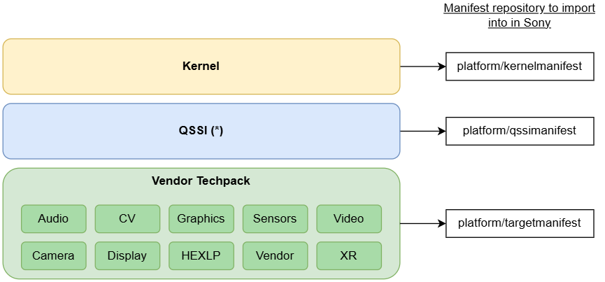

# Import_Qcom_<distro>_Vendor_techpack_<project>

> **Sources:** 📊 PPT slides 5–9 · 🎙 KT Sessions 3–5 · 🧭 proposed · ❓ unconfirmed. The current import scripts are not in the checkout.
> **Background:** [CodeSync_KT.md §10.9 Gitification & two-run procedure](../../CodeSync_KT.md#109-gitification-and-the-two-run-techpack-procedure). The stage list and common parameters are in [07-import-qcom-kernel.md](07-import-qcom-kernel.md).

---

## 1. Job Identification

| Field | Value |
|---|---|
| **Job Name** | `Import_Qcom_<distro>_Vendor_techpack_<project>`. 📊 Examples: `Import_Qcom_2024-spf-1-0_Vendor_techpack_V-Shimanto`, `…2023-spf-2-0_Vendor_techpack_V-Asahi`, `…_U-Asahi`, `…_V-Yodo`, `…_U-Yodo`, `…_T-Yodo`. ❓ Current names: see Jenkins. |
| **Job URL** | Prod: `https://codesync.ptc.sony.co.jp/job/Import_Qcom_<distro>_Vendor_techpack_<project>/` |
| **Category** | Vendor Import |
| **Vendor / Source** | Qualcomm: Chipcode + CodeLinaro |
| **Component** | Vendor Techpack (Audio, CV, Graphics, Sensors, Video, Camera, Display, HEXLP, Vendor, XR) → Sony manifest `platform/targetmanifest` |
| **Criticality** | 🧭 **Critical.** Most error-prone import. A silently dropped file or an unhandled new artifact gives teams incomplete code. |



## 2. Purpose / Job Description

**What does this job actually do?**
It imports one Qualcomm vendor release through the 10 stages ([07 §2](07-import-qcom-kernel.md#2-purpose--job-description)) in `vendor_st/` or `vendor_techpack_st/` (depending on platform generation ❓). In addition, Qualcomm ships the techpack artifacts and `prebuilt_HY11` as **plain directories**, except `display/LE`, which arrives as a git. **CodeSync gitifies each one** (`git init` / commit / push) in the `hy11` stage so teams can consume them individually.

**Checksum bracket** (🎙):
```
syncsnap (after download): write <checksum> <path> <project> <size> for every file in techpack_artifacts/ and prebuilt_HY11/
hy11:                      gitify + push
ref-push (before pushing): regenerate the checksums from the .git content → compare → mismatch = ABORT
```

**Why is this job required?**
Product vendor builds use `platform/targetmanifest`. Different Sony teams consume individual techpack artifacts, so each must exist as its own git, complete and tagged.

## 3. Trigger Information

| Field | Value |
|---|---|
| **Trigger Type** | **Manual**, run **twice** per release (two-run procedure) |
| **Schedule** | None |
| **Manual Trigger Allowed?** | Yes (the only way) |
| **When to trigger manually** | A new release for a Sony distro, with the vendor tag on **both CLO and Chipcode** (`list_manifest_tags`), and the parameters peer-reviewed |
| **Triggered by another job?** | No |
| **Downstream Jobs** | None automatic. Completion email. |

**Flow:** `Release → list_manifest_tags → Run 1 (stop at syncsnap-notdefault, inspect artifacts) → [patch if new artifact] → Run 2 (full fresh) → platform/targetmanifest @ REF_BRANCH + AU_TAG → email`

## 4. Job Parameters

> 📷 **Screenshots:** _add "Build with Parameters" for **Run 1** and **Run 2**_ → `../images/import-techpack-run1-params.png`, `../images/import-techpack-run2-params.png`

**Two-run settings** (🎙, current policy agreed with Sony):

| | Run 1 | Run 2 |
|---|---|---|
| `STOP_BUILD_AT_STAGE` | `syncsnap-notdefault` | *(blank)* |
| `SKIP_STAGES_BEFORE` | *(blank)* | *(blank)*. **Not** a resume (the old policy was to resume, now changed). |
| `CLEANUP_WORKING_DIR` | ✅ | ✅ |
| Purpose | Download, stop, **inspect artifacts** | Full fresh run to completion |

| Parameter | Mandatory? | Example | Description | How to determine value | Risk if wrong |
|---|---|---|---|---|---|
| `AU_TAG` | **Yes** | `AU_LINUX_ANDROID_LA.VENDOR.…` | Vendor tag | Release note → **vendor** row, chipset matches. `list_manifest_tags` (CLO + Chipcode). | Wrong vendor software imported |
| `RELEASE_NUMBER` | **Yes** | full number | Vendor release | Release note | Import mismatch |
| `REF_BRANCH` | **Yes** (defaulted) | vendor ref branch | Branch pinned | Default. Volatile only if needed. | Wrong branch updated |
| `SENSOR_TAG` `XR_TAG` `HEXLP_TAG` `GRAPHICS_TAG` `WLAN_TAG` `BFTM_TAG` | **Conditional**: mandatory up to Shimanto, unused on recent platforms | per artifact | Additional techpack tags | Release note "Android build information" table | Older platforms: an artifact imported at the wrong version, or missing |
| `STOP_BUILD_AT_STAGE` | Run 1: **Yes** | `syncsnap-notdefault` | Halt after download | Fixed value | Blank on Run 1 means it pushes before you have inspected |
| `CLEANUP_WORKING_DIR` | Yes | ✅ (both runs) | Fresh workspace | Always checked under the current policy | Stale artifacts from the previous release |
| `PSEUDO_MIRROR_TREE` | No | ✅ | Workspace mirror | Enabled unless the path is broken | Slow, or a failure |
| others | — | — | As in [07 §4](07-import-qcom-kernel.md#4-job-parameters) | | |

Project variables: `tree_type=LA_vendor_techpack_<product>` (older) or `vendor_techpack` (newer), `hy11_suffix=<product codename>`, workspace `vendor_st` or `vendor_techpack_st` (🎙 cosmetic split. ❓ **Confirm which product uses which before inspecting.**)

## 5. Expected Output

**After Run 1:**
- Tree downloaded. Techpack artifact directories present under the workspace techpack path.
- Recorded in the ticket: *"artifacts present: <list>; only display/LE is a git; no new techpack artifacts"*

**After Run 2:**
- **Every techpack artifact gitified** and pushed as its own git. `display/LE` stays at its own upstream path (`…/qcom-proprietary/…`).
- Gitified artifacts listed under the *gitified artifacts* path in the ref manifest (same path as the previous release)
- Checksum bracket passed (no abort)
- `prebuilt-hy11-<product>` pushed. `grease/$AU_TAG.xml` in `platform/targetmanifest`.
- `REF_BRANCH` pinned. **Every project tagged `$AU_TAG`.**

## 6. Output Validation / Success Criteria (Mandatory)

### Level 1: Jenkins
- **Run 1:** stops after `syncsnap-notdefault` as intended (not a failure)
- **Run 2:** **SUCCESS**, final stage **`ref-tag`**. **No checksum-mismatch abort** in `ref-push`. Tag counters: OK + exists = all, `failed = 0`.

### Level 2: Git / Mirror
```bash
# Run 1 – on the code-sync node, in the job workspace
ls <workspace>/vendor*_st/<techpack_artifacts path>/                 # list artifacts
for d in <workspace>/vendor*_st/<techpack_artifacts path>/*/ ; do
  [ -d "$d/.git" ] && echo "GIT   $d" || echo "DIR   $d"; done          # expect only display/LE = GIT
# Run 2 – review server
git ls-remote --tags git://review.ptc.sony.co.jp/platform/targetmanifest "$AU_TAG"
git ls-remote --tags git://review.ptc.sony.co.jp/<gitified-artifact-project> "$AU_TAG"   # for each artifact
```

### Level 3: Manifest
- `default.xml` on `REF_BRANCH`: every artifact appears under the *gitified artifacts* path. Diff it against the **previous release's** manifest. The same set plus any newly added artifact is expected.
- `display/LE` is **not** under that path (it is at its upstream path)
- `grease/$AU_TAG.xml` present

### Level 4: Sync validation
VNC: `repo init -u git://review.ptc.sony.co.jp/platform/targetmanifest -b $REF_BRANCH && repo sync -c` before and after. SHA-1 diff `remote_hashes.txt` (from `vendor_st`) vs `local_tags.txt`. **Techpack: the only differences allowed are the techpack artifacts** (gitified by Sony, plain directories upstream). Any other project in the diff is a real problem. Attach the project list and diff to Jira.

## 7. Failure & Troubleshooting History

| Date | Error / Symptom | Root Cause | Identification | Fix / Recovery | Jira | Preventive Action |
|---|---|---|---|---|---|---|
| 🧭 risk (reason for Run 1) | A new techpack artifact from Qualcomm is not gitified or pushed | Artifact missing from the script's artifact list | Run 1 inspection | Add it to the list (patch → stage → review → prod). **Make sure its repository exists on review**, because manually gitified artifacts are **not** auto-created. Then Run 2. | ❓ | Never skip Run 1 |
| ❓ (KT Session 4) | Job aborted in `ref-push` with a checksum mismatch | A file was lost or altered during gitification | `ref-push` log | Investigate the missing file. Fresh rerun. | ❓ owed (KT §16.1 #4) | Checksum bracket (built in) |
| ❓ (policy change) | Issues carried over when Run 2 resumed from Run 1's workspace | Partial workspace state | — | **Changed to a fresh full Run 2** (agreed with Sony) | ❓ | Use the fresh-run form |
| ❓ recurring | Network failures | Network | Console | Full rerun (syncsnap) / resume (later stages) | — | — |

## 8. Recovery / Rerun Procedure

**Is rerun safe?** **Conditional.**
- A failure in Run 2 at `syncsnap` → fresh rerun
- A failure in Run 2 after `hy11` → resume (`SKIP_STAGES_BEFORE=<stage>`, cleanup **unchecked**)
- A **checksum abort** → do **not** resume past it. Find the cause, then do a fresh run.

**Before rerun check:**

| Check | How |
|---|---|
| Was the upstream source available? | `git ls-remote --tags` on the Chipcode and CLO vendor manifests for `$AU_TAG`. On older platforms, also the extra techpack tags. |
| Did the previous build partially push anything? | After `hy11`, gitified artifacts are already on review. After `ref-push`, the ref branch is partly moved. Resume, or coordinate a rollback. |
| Is the Jenkins workspace clean? | Run 1 and fresh Run 2: checked. Resume: unchecked. |
| Is another CodeSync job running against the same repository? | Other vendor imports that share `vendor_st` / `vendor_techpack_st` (lock file) |
| Does anything need rollback or cleanup? | An artifact pushed to the wrong or new project name → ask Sony CM. Wrong tag or branch → agree on a rollback first. |
| Has the Qualcomm import script changed? | Check the release note for new `sync_snap_v2.sh` options, new artifacts, new remotes, and public/private paths |
| Does the script need adapting for the new tag or branch? | New artifact → artifacts list + repo creation. New remote → push filter. Path move → 3 places. |
| Should an obsolete branch be moved aside? | Prefer a volatile branch. If Sony requires a reset: back up `<REF_BRANCH>-obsolete-<yymmdd-HHMM>` using the service account, then rerun. |

**Rerun steps:**
1. Identify the stage and record it in the ticket.
2. Rerun per the rules above (fresh, resume, or investigate the checksum).
3. Repeat all of §6, including the artifact checks.
