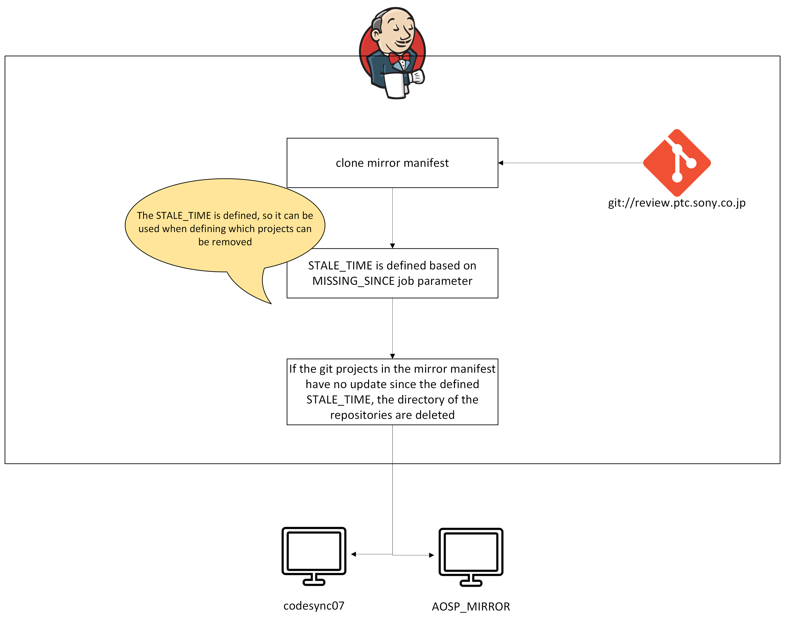

# Delete stale repository in mirror (`delete_stale_repository_mirror_*`)

> **Sources:** 📊 PPT slides 30–32 · 🧭 proposed · ❓ unconfirmed. This job is not in the older checkout.
> **Background:** [CodeSync_KT.md §11.2](../../CodeSync_KT.md#112-delete-stale-repository-in-mirror)

---

## 1. Job Identification

| Field | Value |
|---|---|
| **Job Name** | `delete_stale_repository_mirror_review-plus.ptc.sony.co.jp_codesync07` · `delete_stale_repository_mirror_partner-android.googlesource.com_AOSP_MIRROR` |
| **Job URL** | Prod: `https://codesync.ptc.sony.co.jp/job/delete_stale_repository_mirror_review-plus.ptc.sony.co.jp_codesync07/` and `…/job/delete_stale_repository_mirror_partner-android.googlesource.com_AOSP_MIRROR/` |
| **Category** | Cleanup |
| **Vendor / Source** | Sony `review-plus` mirror; Google partner-android mirror |
| **Component** | Local git mirror |
| **Criticality** | 🧭 **Normal**, but **destructive.** It deletes mirror repositories. |

## 2. Purpose / Job Description

**What does this job actually do?**
📊 It clones the mirror manifest from `git://review.ptc.sony.co.jp`, defines `STALE_TIME` from `MISSING_SINCE`, and for each git project in the mirror manifest compares its latest commit with `STALE_TIME`. If there has been no change since then, it **deletes the repository directory** from the mirror. It also **reports untracked files** for projects updated more recently than the stale time.



**Why is this job required?**
Repositories that are no longer updated (retired branches, removed gits) waste mirror disk space and slow down `repo sync` of the mirror.

## 3. Trigger Information

| Field | Value |
|---|---|
| **Trigger Type** | ❓ Manual or scheduled. Check *Configure*. |
| **Schedule** | ❓ |
| **Manual Trigger Allowed?** | Yes |
| **When to trigger manually** | Mirror disk pressure; after retiring release branches; periodic housekeeping. **Always do a `DRY_RUN` first.** |
| **Triggered by another job?** | No |
| **Downstream Jobs** | None. The matching Update Mirror job re-fetches anything still in the manifest. |

## 4. Job Parameters

> 📷 **Screenshot:** _add "Build with Parameters"_ → `../images/delete-stale-repo-params.png`

| Parameter | Mandatory? | Example | Description | How to determine value | Risk if wrong |
|---|---|---|---|---|---|
| `MISSING_SINCE` | Yes | ❓ e.g. `6 months ago` (format to be confirmed) | Defines `STALE_TIME` | Agree with the team. Be conservative. | Too short **deletes live repos**. The next imports and syncs lose the reference and run slowly while the mirror re-downloads. |
| `DRY_RUN` | Yes | ✅ checked | Report only, no deletion | **Checked** first. Uncheck only after reviewing the dry-run list. | Unchecked by mistake deletes without review |
| `USE_LOCAL_SCRIPTS` | No | unchecked | Overlay local scripts | Unchecked in prod | Unreviewed code |

## 5. Expected Output

- **Dry run:** a list of repositories that would be deleted, plus the untracked-files report
- **Real run:** those directories removed from the mirror. Disk space recovered.

## 6. Output Validation / Success Criteria (Mandatory)

### Level 1: Jenkins
- **SUCCESS**. The deletion list matches the reviewed dry-run list.

### Level 2: Git / Mirror
```bash
df -h <mirror volume>                                      # before/after
ls <MIRROR_ROOT>/<name>/<deleted-project>.git              # gone
# none of the deleted projects appear in any active manifest:
grep -l '<deleted-project>' <active manifests>             # expect nothing
```

### Level 3: Manifest
Each deleted project is either absent from active product, sync and import manifests, or genuinely unchanged since `STALE_TIME`.

### Level 4: Sync validation
The next run of the matching Update Mirror job is **SUCCESS**. The next sync job on that mirror shows no unexpected full downloads.

## 7. Failure & Troubleshooting History

| Date | Error / Symptom | Root Cause | Identification | Fix / Recovery | Jira | Preventive Action |
|---|---|---|---|---|---|---|
| | | | | | | |

## 8. Recovery / Rerun Procedure

**Is rerun safe?** **Conditional.** A dry run is always safe. A real run is safe only after the dry-run list has been reviewed. **There is no undo.** A wrongly deleted repo must be re-mirrored, either by the next Update Mirror run (if it's in the manifest) or by hand.

**Before rerun check:**

| Check | How |
|---|---|
| Was the upstream source available? | `git ls-remote git://review.ptc.sony.co.jp/mirror/manifest` |
| Did the previous build partially delete anything? | Compare the last log with the disk |
| Is another CodeSync job running against the same repository? | **Do not run while the matching Update Mirror job or any import is running.** |
| Does anything need rollback or cleanup? | A needed repo was deleted → trigger the Update Mirror job (it re-fetches everything still in the manifest) |
| Does the job need adapting? | No |

**Rerun steps:** `DRY_RUN` ✅ → review the list → `DRY_RUN` ☐ → Level 1–2 checks.
